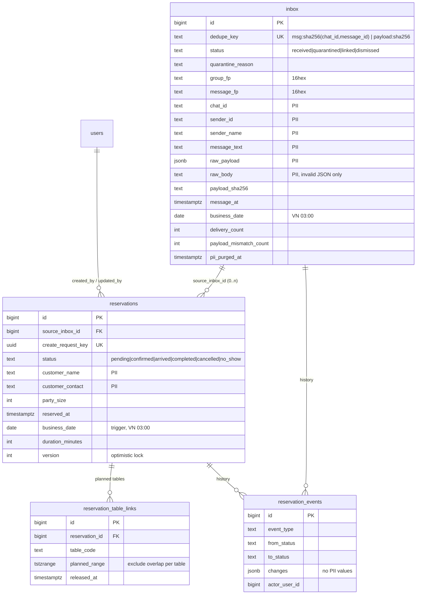

# BABA 예약 관리 Phase 1 — Zalo Inbox · 예약 DB 기반

상태: 로컬 구현·격리 DB 검증 완료. **운영 Migration 미적용 · Main 미병합 · 미배포.**

- Migration: `supabase/migrations/20261114120000_create_reservation_inbox_foundation.sql`
- 롤백 SQL(수동, 별도 승인): `supabase/reservation_inbox_foundation_rollback.sql`
- Webhook: `app/api/integrations/zalo-bot/route.ts`, `lib/zalo/webhook-poc.ts`, `lib/reservations/zalo-inbox-store.ts`
- 테스트: `tests/zalo-webhook-poc.test.ts`(PoC 회귀), `tests/zalo-webhook-persist.test.ts`, `tests/reservation-inbox-db.test.mjs`(PGlite)

## 0. PoC 근거 (보존)

| 항목 | 값 |
|---|---|
| PoC 커밋 | `676dedc1`(최초), `d51708b0`(보안·allowlist 보완) |
| 실제 수신 | 2026-11-14 08:08:25Z `TEST BABA 005`, 08:19:54Z `TEST BABA 006` (`ua=java`) |
| 판정 | `message.text.received`, `chat_type=GROUP`, `group_text_received`, HTTP 200 |
| BABA 예약 단체방 `group_fp` | `63af6b0e794dddf3` (allowlist 적용 상태에서 006 `observed=true`) |
| 보안 조건 | Secret 헤더 검증(401), Secret 미설정 시 503, 64KiB 제한, 로그에 원문·연락처·발신자·그룹 원본 ID 없음 |
| 정리 | 오너가 Bot Creator Webhook 해제 확인 후 PoC Quick Tunnel·프록시·3917 서버 종료(요청 총 16건) |

## 1. 기존 스키마 분석 결과

- 운영 DB(읽기 전용 조회)와 저장소 모두 예약·테이블·고객 관련 테이블이 **없음**(`bar_zones`는 술 보관 구역이라 무관).
- 인증은 Supabase Auth가 아니라 앱 세션(`users.id`)을 쓰고, 서버는 `service_role`로 접근한다. 따라서 직원 권한은 **RPC가 `p_actor_user_id`의 `users.role`·`is_active`·`app_login_enabled`를 검사**하는 기존 방식(bar keeping, ledger 등)을 따른다.
- 민감 데이터는 `*_private` 스키마에 두고 RLS 활성화·전 역할 권한 회수·security definer RPC만 `service_role`에 부여하는 기존 패턴(`pos_ingest_private` 등)을 따른다.
- `btree_gist`·`pgcrypto`는 `extensions` 스키마에 이미 설치되어 있다(급여 중복 기간 exclusion에서 사용 중).
- 최신 적용 Migration `20261112091707` → 신규 파일은 `20261114120000`.

## 2. ERD



- 물리 이름은 `reservation_private.inbox`(요청서의 `reservation_inbox`), `reservations`, `reservation_events`, `reservation_table_links`이다.
- 테이블 마스터가 없으므로 `table_code`(`A1`, `VIP-2` 형식, 대문자 정규화)로 참조한다. Phase 2에서 테이블 마스터를 만들면 FK로 승격한다.
- **예정과 점유 분리**: `reservation_table_links`는 예약 시간대의 *배정 계획*만 담는다. 실제 착석·주문(POS) 점유는 저장하지 않는다. `arrived`가 돼도 계획은 유지되고, `completed/cancelled/no_show`가 되면 자동 해제된다.

## 3. 데이터 흐름

```
Zalo ──POST──► /api/integrations/zalo-bot
  1 Secret 검증 (없음/불일치 401, 미설정 503)
  2 persist 모드: allowlist 비어 있으면 503 (fail-closed)
  3 64KiB 제한 (413), 빈 본문 200(저장 안 함)
  4 판정 (buildZaloInboxPlan — 재처리와 공용)
      다른 그룹(PRIVATE 제외) ─────────► 저장 안 함, 200
      Bot 자신의 메시지 ─────────────► 저장 안 함, 200
      허용 그룹 텍스트 ──────────────► inbox 'received'
      잘못된 JSON·알 수 없는 형태·비텍스트·PRIVATE·ID 누락 ─► inbox 'quarantined'(+사유)
  5 reservation_inbox_ingest_v1 커밋 성공 → 200 / 실패 → 503 (ACK 안 함)

직원(leader+) ─► inbox 검토 ─► reservation_create_v1 (pending) ─► confirmed ─► arrived ─► completed
                     │                                   └► cancelled(사유 필수) / no_show
                     ├► dismiss (무시)
                     └► reprocess (격리 건을 현재 파서로 재판정, 같은 payload hash만)
```

Webhook은 예약을 **만들지도, 확정하지도 않는다**(테스트로 확인).

## 4. 요구 조건 대응

| 조건 | 구현 | 검증 |
|---|---|---|
| 중복 수신 시 중복 예약 금지 | inbox `unique(source,dedupe_key)` + `on conflict` 카운트. 예약은 직원만 만들고 `requestKey`(uuid unique)로 중복 제출을 차단. 재처리 시 동일 메시지가 이미 있으면 `dismissed duplicate_of` | DB·단위 테스트 |
| 인증·allowlist 유지 | Secret 검증 그대로. persist 모드는 allowlist 필수, 모든 이벤트 유형에 적용 | 단위 테스트 |
| 저장 성공 후에만 성공 응답 | RPC 커밋 결과를 받은 뒤 200, 예외·비정상 응답은 503 | DB 테스트(함수 제거 시 503, 저장 0건) |
| 저장 실패 시 유실 방지 | 503으로 ACK하지 않음 + `persist_failed` 로그(`message_fp`·`group_fp`·오류코드)로 누락 탐지 | 단위·DB 테스트(재시도 1건만 저장) |
| 비정상 메시지 격리·재처리 | `quarantined`(사유 5종), 원본 보존, `reservation_inbox_reprocess_v1` | DB 테스트 |
| 연락처 RLS·권한 | private 스키마, RLS, 전 역할 권한 회수, 목록은 항상 마스킹(`***567`), 원문 연락처는 상세에서 manage 권한만 + `contact_viewed` 감사 | DB 테스트 |
| 원본 보존·삭제 정책 | §6 | DB 테스트(dry run·실행·멱등) |
| 상태 이력 | `reservation_events` append-only(UPDATE/DELETE/TRUNCATE 차단), 개인정보 값 미기록(필드명만) | DB 테스트 |
| 03:00 영업일·VN 시간대 | `reservation_private.business_date()` = `getBusinessDate()`. 입력 시각은 오프셋 필수 | DB 테스트(경계 7개, 세션 TZ 변경) |
| 로그 노출 금지 | 원문·연락처·발신자·Secret·그룹 원본 ID 미출력, DB 오류는 코드만 | 단위·DB 테스트 |
| 예정/점유 분리 | §2 | DB 테스트 |

### 확인되지 않은 Zalo 동작 (단정 금지)

- **재전송 규칙**: non-2xx·타임아웃 후 재전송 여부·횟수·간격 모두 문서에 없고 관찰한 적도 없다. 재전송이 없다면 DB 장애 중 들어온 메시지는 유실될 수 있다. 이때는 `persist_failed` 로그를 보고 단체방에서 직접 확인해야 한다.
- `message_id`의 전역 유일성: 확인 안 됨 → `(chat_id, message_id)`로 키를 잡는다.
- `message.date` 단위: 확인 안 됨 → `>=1e11`이면 ms, 아니면 초, 2020~2100 밖이면 null로 둔다(`received_at`으로 영업일 계산).
- 메시지 수정 이벤트: 확인 안 됨 → 같은 ID에 다른 payload가 오면 첫 원본을 유지하고 `payload_mismatch_count`·이벤트로 표시한다.
- 멘션 필드: 문서에 없고 실제 이벤트에도 없었다(`mention_field=false`).

## 5. 권한

| 동작 | staff | leader | manager | owner/master |
|---|---|---|---|---|
| 예약 목록·상세(연락처 마스킹) | ○ | ○ | ○ | ○ |
| 연락처 원문 보기(감사 기록) | × | ○ | ○ | ○ |
| inbox 목록·원문·재처리·무시 | × | ○ | ○ | ○ |
| 예약 생성·수정·상태 변경·테이블 배정 | × | ○ | ○ | ○ |
| 개인정보 보존기간 삭제 | × | × | × | ○ |

비활성(`is_active=false`)·로그인 차단(`app_login_enabled=false`)·미존재 사용자는 모두 `forbidden`이다. **staff 조회 허용 여부와 leader의 연락처 열람 권한은 오너 확인이 필요한 제안값이다.**

## 6. 개인정보 보존기간 (제안)

| 대상 | 기간 | 처리 |
|---|---|---|
| inbox `linked`/`dismissed` | 수신 후 90일 | 원문·raw·발신자·chat/message id를 null로 |
| inbox `received`/`quarantined`(미검토) | 수신 후 180일 | 위와 같음 |
| 예약 `completed`/`cancelled`/`no_show` | 영업일 후 365일 | 이름 `-`, 연락처·메모 null |

- 상태·지문·hash·횟수·날짜와 이력은 남는다.
- `reservation_purge_expired_pii_v1`은 owner/master만 실행할 수 있다. 기본값이 dry run이며, 미래 시각은 거부한다.
- Phase 1에서는 자동 스케줄이 없고 오너가 수동으로 실행한다.

## 7. /admin/reservations 조회 API 설계 (Phase 2에서 구현)

모든 라우트는 `requireRole([...])`로 1차 차단하고, RPC가 actor 권한을 다시 검사한다. RPC의 `status`는 HTTP 코드로 매핑한다: `forbidden` 403, `not_found` 404, `version_conflict`·`table_conflict`·`invalid_transition` 409, `invalid_input`·`reason_required`·`invalid_source` 400.

| Method · Path | RPC | 비고 |
|---|---|---|
| GET `/api/admin/reservations?from&to&status` | `reservation_list_v1` | 최대 93일, 연락처 마스킹 |
| GET `/api/admin/reservations/[id]?reveal=1` | `reservation_get_v1` | reveal 시 감사 이벤트 |
| POST `/api/admin/reservations` | `reservation_create_v1` | 클라이언트가 `requestKey` uuid 생성 |
| PATCH `/api/admin/reservations/[id]` | `reservation_update_v1` | `expectedVersion` 필수 |
| POST `/api/admin/reservations/[id]/transition` | `reservation_transition_v1` | 취소 사유 필수 |
| POST/DELETE `/api/admin/reservations/[id]/tables` | `link_table_v1` / `release_table_v1` | 충돌 시 상대 예약 id |
| GET `/api/admin/reservations/inbox?from&to&status` | `reservation_inbox_list_v1` | leader+ |
| GET `/api/admin/reservations/inbox/[id]` | `reservation_inbox_get_v1` | raw 포함 |
| POST `/api/admin/reservations/inbox/[id]/reprocess` | get → `buildZaloInboxPlan` → `reprocess_v1` | allowlist 밖이면 dismiss |
| POST `/api/admin/reservations/inbox/[id]/dismiss` | `reservation_inbox_dismiss_v1` | |

## 8. 운영 적용 절차 (승인 단계별)

1. **코드 병합·배포**(승인 1): `ZALO_BOT_WEBHOOK_MODE`를 설정하지 않은 채 배포한다. observe 모드라 기존 PoC와 동작이 같고, DB 의존성이 없다(DB 클라이언트를 지연 로드).
2. **Migration 적용**(승인 2, 별도): 대상은 신규 스키마 1개, 테이블 4개, 헬퍼·트리거, public RPC 13개다. 기존 테이블·함수·데이터 변경은 0건이다. 적용 후 확인할 것:
   - 스키마·함수 개수
   - `has_function_privilege('anon', …)` = false
   - RLS on
3. **운영 env**(승인 3): `ZALO_BOT_WEBHOOK_MODE=persist`, `ZALO_BOT_WEBHOOK_POC_ALLOWED_GROUP_IDS=63af6b0e794dddf3`, `ZALO_BOT_WEBHOOK_SECRET`(새 값 권장), `SHOW_GROUP_ID=false`
4. **Webhook 등록**: 오너가 Bot Creator에 운영 URL과 Secret을 등록하고 `TEST BABA 008`을 보낸다. 로그에서 `stored=true`, `inbox_status=received`를 확인한다.

### 위험

- Migration 없이 persist를 켜면 모든 수신이 503이 된다(fail-closed, 유실 위험). 그래서 2 → 3 순서를 지켜야 한다.
- Zalo 재전송 규칙이 불명이라 DB 장애 시 유실될 수 있다(§4).
- PRIVATE 메시지(고객이 Bot에 직접 보낸 DM)도 격리 저장된다. 개인정보이므로 보존기간 정책이 적용된다. 저장 자체를 원하지 않으면 drop으로 바꾸는 한 줄 수정으로 처리한다.
- Vercel 로그에는 원문이 없다. 원문은 DB에만 있으므로 DB 접근 통제가 핵심이다.

### 롤백

- **즉시**: `ZALO_BOT_WEBHOOK_MODE`를 제거하고 재배포하면 observe 모드로 돌아간다(저장 중단, 데이터는 보존). Bot Creator에서 Webhook 해제도 가능하다.
- **코드**: 병합 커밋을 revert한다(Migration과 독립).
- **DB**: `supabase/reservation_inbox_foundation_rollback.sql`을 쓴다. 데이터가 있으면 스스로 중단되므로, export와 오너 승인 후에만 실행한다. Migration 이력 행 정리는 별도 승인이다.

## 9. Phase 2 UI 제안

1. `/admin/reservations` 일자 보드: 영업일 03:00 기준 타임라인, 상태 칩, 인원 합계, 테이블별 계획 막대(충돌 표시).
2. Inbox 패널: `received` 원문 옆에 생성 폼(이름·연락처·인원·시각·메모), `quarantined` 탭(사유·재처리·무시), `payload_mismatch` 배지.
3. 상세 드로어: 이력 타임라인, 연락처 "보기" 버튼(감사 안내 문구), 낙관적 잠금 충돌 시 새로고침 안내.
4. 테이블 마스터 도입과 `table_code` FK 승격, 실제 점유(POS 주문)와의 대조 화면(읽기 전용).
5. 다음 Phase의 AI 추출: inbox 원문 → 생성 폼 *제안값*만 채우고, 직원 확인 없이는 저장하지 않는다.
6. 보존기간 정책 확정 후 정기 실행(Cron), staff 권한 범위 확정, vi/ko 문구.
